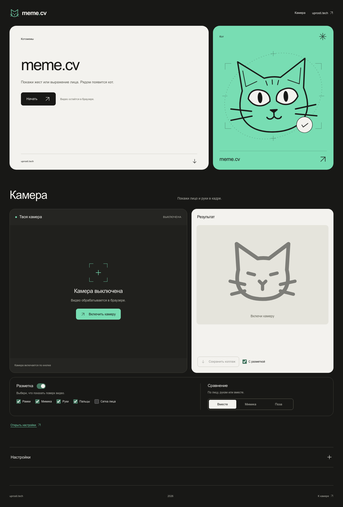

# meme.cv

[](https://github.com/NotAKes/meme-cv/actions/workflows/ci.yml)
[](https://meme-cv.uprosti.tech)

Computer vision in the browser: match facial expressions and hand gestures to cat memes in real time. Built with TypeScript, MediaPipe and Canvas. Inference runs on the device; camera frames are not uploaded.

**[Открыть демо](https://meme-cv.uprosti.tech)** · [Пайплайн подробно](docs/PIPELINE.md) · [Развёртывание](docs/DEPLOYMENT.md)



## Что это

Браузерное CV-приложение, которое подбирает один из восьми котомемов по мимике и жестам человека перед камерой. Камера слева, результат справа. Разметку лица, рук и пальцев можно включать отдельно.

Проект [uprosti.tech](https://uprosti.tech). Стек: React, TypeScript, Vite, MediaPipe Tasks Vision, Canvas, Vitest, Playwright.

## Пайплайн

```text
Камера / getUserMedia
        │
        ├── Face Landmarker ───── лицо, blendshapes, матрица головы
        ├── Pose Landmarker ───── плечи, локти, запястья
        └── Gesture Recognizer ── точки кистей, world landmarks, Closed_Fist
                    │
          Нормализованные признаки
          рот / глаза / наклон головы / положение рук / жесты
                    │
          Локальный анализ области рта
          цвет и форма или персональные числовые образцы
                    │
          Подтверждение языка во времени
          Необязательная калибровка лица
          EMA-сглаживание признаков
                    │
          Сигнатурные правила + weighted RMS
          Пропущенные измерения, зеркальное сравнение рук
                    │
          Стабилизация выбора / 350 мс
                    │
          Котомем + независимый Canvas Overlay
```

Три модели выполняются **последовательно**, на CPU/WASM в основном потоке браузера. Анализ запускается не чаще одного раза в 65 мс. Это ограничение частоты, а не обещание 15 FPS на любом устройстве.

### Что реализовано поверх MediaPipe

- **Признаки лица.** Открытие рта из `jawOpen`, глаза из blink/wide blendshapes, наклон головы из матрицы преобразования. Геометрия точек служит запасным источником там, где она реализована.
- **Жесты.** Кулак объединяет `Closed_Fist`, сгибание пальцев и сохранённые персональные образцы, если они есть. 🤙 использует отведение большого пальца, выпрямление мизинца и сгибание остальных. 👉👈 использует близость кончиков указательных пальцев и противоположные направления.
- **Язык.** Экспериментальная цветовая сегментация области рта: контраст относительно щёк, связные компоненты, положение и размер. Не отдельная обученная нейросеть. Необязательная калибровка заменяет эвристику сравнением 107-мерных числовых дескрипторов.
- **Подбор.** Для обычных поз используется взвешенное RMS-расстояние по доступным признакам. Для уверенных жестов и подтверждённого языка есть отдельные правила. 🤙 не зависит от открытого рта или языка.
- **Стабилизация.** Короткие пропуски языка объединяются во времени, затем признаки сглаживаются. Смена картинки требует устойчивого кандидата в течение 350 мс.
- **Диагностика.** Раздельные оценки модели и геометрии кисти, значения пальцев, локальный crop рта, сигналы и время анализа.

Целевые признаки котомемов размечены вручную как похожие **человеческие** позы. Модели не анализируют анатомию котов. Обучение собственных нейросетей в проект не входит.

## Запуск

Нужен **Node.js 24 LTS**, npm и браузер с WebAssembly. Для камеры нужен `localhost` или HTTPS.

```bash
git clone https://github.com/NotAKes/meme-cv.git
cd meme-cv
npm ci
npm run dev
```

Открой адрес Vite, нажми **«Начать»** и разреши камеру. При первом запуске браузер загружает движок и три модели. Видео появляется до окончания загрузки, прогресс показан в КБ.

Калибровка **необязательна**. Подбор начинается после загрузки моделей. Для настройки открой **«Настройки»**:

- Нейтральное лицо: запись около 3 секунд.
- Язык: закрытый рот, открытый рот без языка, высунутый язык. По 3,5 секунды на шаг.
- Профиль языка можно сбросить отдельно. Сохранённая калибровка применяется при следующем запуске в том же браузере.

Модели находятся в `public/models`. `postinstall` копирует WASM из установленного пакета MediaPipe. Если npm-скрипты установки отключены, выполни `node scripts/copy-wasm.mjs`.

## Возможности

- Одно лицо, одна поза, до двух кистей.
- Режимы: мимика, поза, вместе.
- Переключаемый CV Overlay: рамки, контуры лица, скелет рук, пальцы, сетка лица.
- PNG-коллаж из кадра камеры и выбранной картинки, с разметкой или без неё.
- Адаптивный интерфейс, клавиатурный фокус, reduced motion.
- Нейтральное оформление по умолчанию. На [`/themes`](https://meme-cv.uprosti.tech/themes) можно выбрать одну из двенадцати палитр. Выбор хранится отдельно от калибровки и применяется на главной.
- Локальная обработка и сохранение числовой калибровки.

## Проверки

```bash
npm run lint
npm test
npm run build
npx playwright install chromium webkit
npm run test:e2e
```

- **94 модульных теста**: геометрия, слияние оценок жестов, калибровка, пиксельный анализ языка, временное подтверждение, ранжирование и стабилизация.
- **14 браузерных тестов**: управление камерой, отказ в доступе, overlay, мобильная ширина, SVG-иконки и палитры в WebKit с профилем iPhone, необязательная калибровка и запись персонального профиля.
- Один браузерный тест запускает настоящие модели на синтетическом видеопотоке. Для проверки мастера калибровки подставляются числовые наблюдения.
- Регрессионные фикстуры содержат реальные числовые выходы MediaPipe на тестовых фотографиях.

CI выполняет линтер, тесты, production-сборку и браузерные проверки. Процент пройденных тестов не является метрикой точности распознавания.

## Ограничения

Это работающий прототип, не готовый универсальный классификатор. Точность на размеченной выборке физических камер пока не измерена.

**Язык остаётся самой нестабильной частью.** Цветовая эвристика зависит от света, камеры, оттенков кожи, помады и перекрытия рта. Персональный профиль может потребовать повторной записи после смены света. Автотесты покрывают конкретные регрессии, но не доказывают устойчивость на всех людях и камерах.

Кисти вне кадра и перекрытые пальцы ухудшают жесты. Модели работают на основном потоке, поэтому слабые устройства могут тормозить. Первая загрузка чувствительна к сети. Коэффициенты признаков и расстояния до мемов не являются вероятностями или процентами сходства. Приложение не определяет личность и эмоции.

## Структура

```text
src/
  App.tsx                    камера, цикл анализа, UI, экспорт
  components/                интерфейс и мастер калибровки
  data/cats.ts               восемь вручную размеченных эталонов
  lib/
    tracker.ts               MediaPipe, загрузка моделей, сбор признаков
    cat-features.ts          геометрия лица и кистей
    hand-gestures.ts         слияние оценок жестов
    tongue.ts                анализ пикселей и дескриптор рта
    tongue-calibration.ts    персональная классификация
    tongue-evidence.ts       подтверждение языка во времени
    matching.ts              ранжирование, EMA, стабилизация
    calibration.ts           нормализация и localStorage
    overlay.ts               Canvas-разметка
    fixtures/                числовые регрессионные данные
public/models/               модели MediaPipe
public/memes/                изображения
scripts/                     подготовка WASM и частей загрузки
e2e/                         браузерные тесты
docs/                        пайплайн, деплой, скриншот
```

## Данные и сеть

Кадры камеры, crop рта и коллаж обрабатываются в памяти браузера. Калибровка сохраняется как числа в `localStorage`. Код также читает старые локальные замены картинок из IndexedDB; редактора изображений в текущем UI нет. Аналитики и API для отправки кадров нет.

JS, WASM, модели и картинки запрашиваются с origin приложения. `npm run build` создаёт сжатые части моделей по 32 КиБ с повторами загрузки. Это уменьшает стоимость повторного запроса при обрыве; плохую доступность сервера не устраняет.

## Дальше

- Собрать согласованную размеченную выборку разных камер и условий освещения.
- Измерять precision/recall языка и жестов, top-1/top-3 подбора и число переключений в минуту.
- Сравнить текущий анализ языка с небольшим обученным классификатором области рта.
- Вынести inference в Web Worker, измерить задержку на мобильных устройствах.
- Расширить проверку браузеров и добавить демонстрационный ролик.

## Лицензия

Код: [MIT](LICENSE). Используемые CV-компоненты и модели перечислены в [THIRD_PARTY.md](THIRD_PARTY.md).
